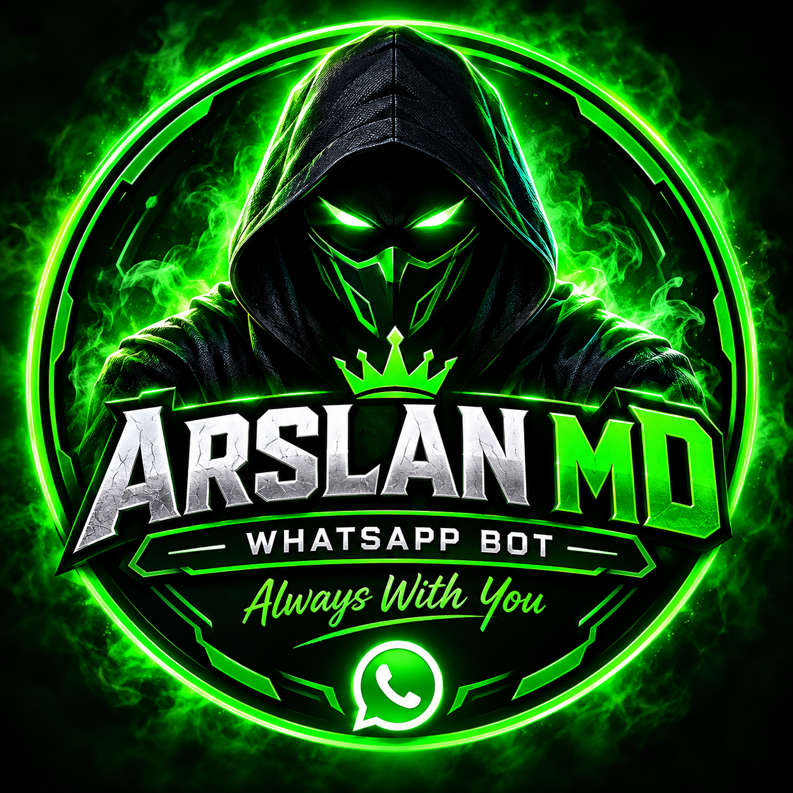

<p align="center">
  <h1 align="center">💜 ARSLAN-MD WHATSAPP BOT 💜</h1>
</p>

<p align="center">
  
  
  
</p>

<p align="center">
  <b>ARSLAN-MD</b> ek powerful, fast, aur multi-feature WhatsApp bot hai jo advanced Baileys library par based hai. Isme Session ID, Pairing Code, aur All-Platform Deployment ki mukammal support hai!
</p>

---
<div align="center">
  

</div>
## 🚀 One-Click Deployments

### 🌟 Heroku
<p align="center">
  <a href="https://heroku.com/deploy?template=https://github.com/ARSLAN-KHAN/ARSLAN-MD">
    
  </a>
</p>

### ☁️ Render
<p align="center">
  <a href="https://render.com/deploy?repo=https://github.com/ARSLAN-KHAN/ARSLAN-MD">
    
  </a>
</p>

### 🚂 Railway
<p align="center">
  <a href="https://railway.app/new/template?template=https://github.com/ARSLAN-KHAN/ARSLAN-MD">
    
  </a>
</p>

### 🪐 Koyeb
<p align="center">
  <a href="https://app.koyeb.com/deploy?type=git&repository=https://github.com/ARSLAN-KHAN/ARSLAN-MD">
    
  </a>
</p>

### 🌐 Replit & Netlify / Panels
<p align="center">
  <a href="https://replit.com/github/ARSLAN-KHAN/ARSLAN-MD">
    
  </a>
  &nbsp;&nbsp;&nbsp;&nbsp;
  <a href="https://arslan-mdx.vercel.app">
    
  </a>
</p>

---

## 📱 Termux Par Deploy Kaise Karein? (Step-by-Step Guide)

Agar aap apne Android phone par Termux ke zariye ARSLAN-MD chalana chahte hain, toh yeh commands aik aik kar ke run karein:

```bash
# 1. Update and Upgrade packages
pkg update && pkg upgrade -y

# 2. Install Git and Node.js
pkg install git nodejs -y

# 3. Clone the Repository
git clone [https://github.com/ARSLAN-KHAN/ARSLAN-MD.git](https://github.com/ARSLAN-KHAN/ARSLAN-MD.git)

# 4. Enter the Bot Directory
cd ARSLAN-MD

# 5. Install Dependencies
npm install

# 6. Start the Bot
npm start
